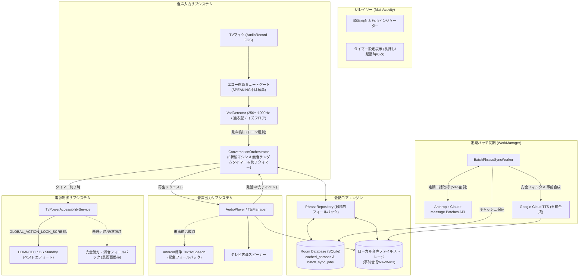
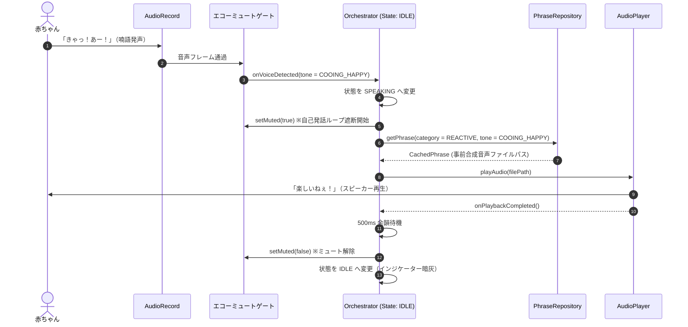

# 全体アーキテクチャ基本設計書 (architecture.md)

- ドキュメントID: `DOC-WF-4`
- プロジェクト: `baby-talk-tv`
- 改訂日: 2026-10-28 (PLレビュー反映版: H3, H6, M5, M7, L5対応)

---

## 1. システム全体構成

---

## 2. 会話状態マシン設計 (H3, M5対応)

状態の不整合やデッドロックを防ぐため、Orchestratorは以下の5状態を厳密に管理します。

| 状態 | 説明 | VAD入力 | インジケーター表示 | タイムアウト/脱出条件 |
|---|---|---|---|---|
| `IDLE` | 待機・見守り中 | 有効 | 暗灰呼吸（4秒周期） | 赤ちゃん発声検知 → `LISTENING` 無音タイマー満了 → `SPEAKING` セッションタイマー満了 → `CLOSING` |
| `LISTENING` | 声検知・特徴量分析中 | 有効 | 淡青点灯 | 解析完了（0.3秒後）→ `SPEAKING` |
| `SPEAKING` | **発話中（音声再生中）** | **遮断（MUTE）** | **淡緑点灯** | **再生完了＋500ms余韻** または **最大15秒タイムアウト** → `IDLE` |
| `CLOSING` | タイマー終了挨拶中 | 遮断（MUTE） | 淡緑点灯 | 挨拶再生完了 または **最大15秒タイムアウト** → `STANDBY` |
| `STANDBY` | セッション終了・TV消灯 | 停止 | 完全消灯（黒） | アプリ再起動またはリモコン操作 |

---

## 3. 主要機能のシーケンス

### 3.1 赤ちゃんの声検知による相槌対話（エコー遮断付き）

### 3.2 無音時の自律語りかけ（ランダム化・M7対応）
- **インターバル**: 120秒〜180秒（2〜3分）の間でランダムに設定（赤ちゃんの眠りを妨げないよう、規則的な機械音感を排除）。
- **音量配慮**: 自律語りかけ時は、通常の相槌会話よりも控えめな音量（-3dB）で穏やかに発話。

---

## 4. プラットフォーム制約・マイク仕様 (H6対応)

### 4.1 Android 14+ フォアグラウンドサービス制約
- 常時マイク監視を行う場合、`AndroidManifest.xml` にて `FOREGROUND_SERVICE_MICROPHONE` 権限と `android:foregroundServiceType="microphone"` を宣言。
- システムトレイ用の控えめな常駐通知（「赤ちゃん見守り中」）を発行。

### 4.2 マイク非搭載テレビ・権限拒否時の縮退動作
- 一部のAndroid TV（内蔵マイクがなくリモコンマイクのみの機種）や、ユーザーがマイク権限を許可しなかった場合:
  - アプリはエラー終了せず、自動的に**「自律語りかけ見守りモード（マイク入力なし）」**へと縮退動作。
  - 無音ランダムタイマー（2〜3分間隔）に基づき、優しく語りかけを継続。
  - 親が困惑しないよう、初回起動時に「マイクが利用できないため、定期語りかけモードで動作します」と控えめに通知。

---

## 5. セキュリティ・プライバシー規程 (L5対応)
1. **秘密情報管理**:
   - Anthropic API Key、Google Cloud API Key はコードやGitに一切含めず、`local.properties` からビルド時に注入。
2. **完全オンデバイス音声処理**:
   - TVマイクからの録音データはメモリ上の一時PCMバッファ内でのみ解析し、**ローカルストレージへの録音ファイル保存やネットワーク送信は一切行わない**。
